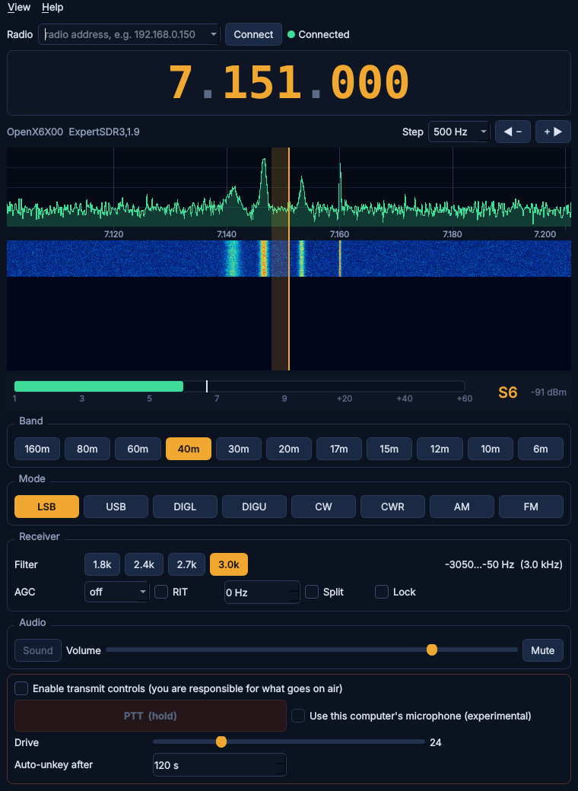

# x6100-tci-remote

A native desktop remote controller for the **Xiegu X6100** running the **OpenX6X00** firmware. It talks to the
radio's built-in **TCI** WebSocket server (default port 50001): tune, change mode/filter/AGC, listen to receiver
audio, read the S-meter, see a **spectrum and waterfall** (click to tune), and (optionally, behind guards) transmit.



## Status (be honest about it)

- The spectrum/waterfall format was captured from a real radio, but the widget itself has only been run against the fake radio so far.
- Verified against a **fake radio** included in this repo, and against the real radio's announced init burst (passive probe).
- **Not yet run against a real radio** end to end. Audio has not been tested on real hardware.
- **Transmit is experimental.** Test only into a dummy load.
- The radio does **not** stream IQ over TCI (tested with `scripts/probe_tci.py`), so there are no own demodulators. The spectrum comes from the radio's panel server (port 50002) instead.

## Install

```bash
python3 -m venv .venv && . .venv/bin/activate
pip install -e ".[gui]"          # or: pipx install ".[gui]"
```

Optional `.deb` (needs PySide6 packages available from your distro): `packaging/build_deb.sh`.

## Run

```bash
x6100-tci-remote 192.168.0.150     # your radio's address (port defaults to 50001)
x6100-tci-remote --demo            # no hardware: starts the built-in fake radio
```

In the radio's web UI (`/tci`) enable TCI. **Listen-only** is enough for monitoring; use **Operate** to control it.

## Spectrum and waterfall

The app also connects to the radio's panel server (port 50002, the same server as the web page `/panel`) and sends only
`screen 0`, `panel 1` and `ping 1`: it turns the screen images off and the spectrum on. It never sends key presses.
Click the spectrum to tune, scroll the wheel to step. The orange band is the receive passband. Level scaling is
automatic (the radio's bin values are not calibrated). Hide it with View > Spectrum & waterfall.

## Safety

- Transmit controls are off until you tick "Enable transmit controls".
- PTT is hold-to-talk, auto-unkeys after a timeout (default 120 s), and unkeys on focus loss, disable and close.

## Development (VS Code)

Open the folder in VS Code and accept the recommended extensions. Run the task **Set up venv**, then use the
launch configs (demo app, fake radio, probe) and the Testing panel. From a shell:

```bash
QT_QPA_PLATFORM=offscreen pytest -q
ruff check .
```

## Docs

- [docs/PROTOCOL.md](docs/PROTOCOL.md) - what the radio exposes and how the app talks to it
- [docs/ROADMAP.md](docs/ROADMAP.md) - next steps

## License

MIT
