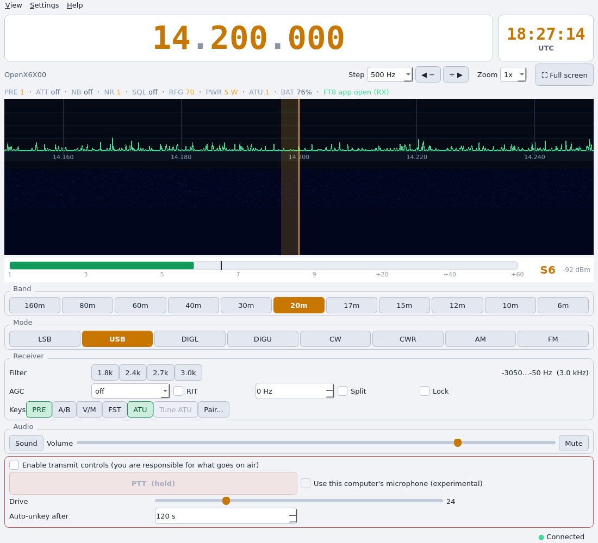
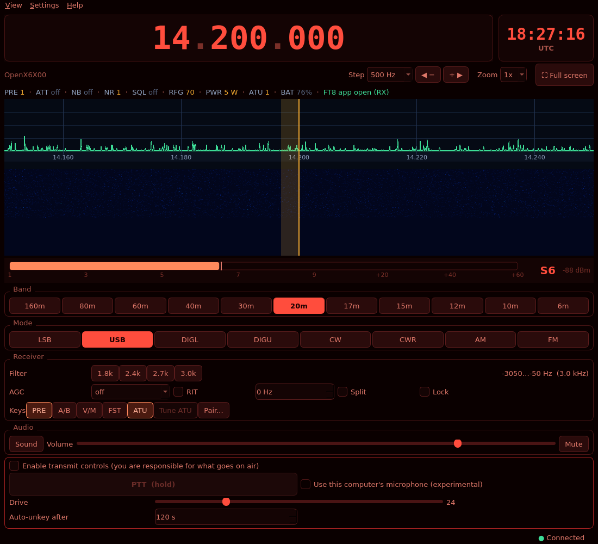
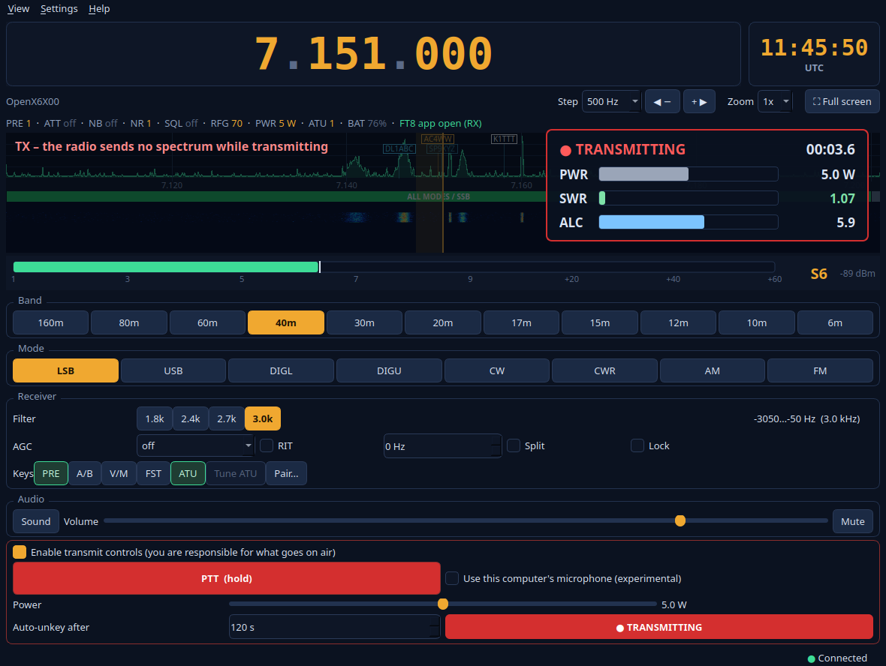

# x6100-tci-remote

A native desktop remote controller for the **Xiegu X6100 and X6200** running the **OpenX6X00** firmware. It talks to the
radio's built-in **TCI** WebSocket server (default port 50001): tune, change mode/filter/AGC, listen to receiver
audio, read the S-meter, see a **spectrum and waterfall** (click to tune), and (optionally, behind guards) transmit.


Themes (Settings > Theme): Midnight (above), Dark, Light and Night red. The pictures are taken with the built-in demo radio.

| Light | Night red |
| --- | --- |
|  |  |

Transmitting: a **TX meter popup** with power, SWR, ALC and a transmit timer appears over the spectrum (see
[Transmit](#transmit)).



## Status

- **Version 0.3.5.** The author has tested it against a real X6100 (OpenX6X00 firmware; the X6200 is expected to work
  the same way but has not been tested): tuning and mode, spectrum and waterfall, pairing, the radio key buttons, the CW
  decoder text and the CW tuner indicator all work.
- Automated tests run against a **fake radio** included in this repo (`x6100-tci-remote --demo`).
- **Transmit is experimental.** Test only into a dummy load.
- The radio does **not** stream IQ over TCI (tested with `scripts/probe_tci.py`), so there are no own demodulators. The
  spectrum comes from the radio's panel server (port 50002) instead.
- Reply formats of the pairing exchange were partly inferred from the radio's web page; see `docs/PROTOCOL.md`.

## Install

```bash
python3 -m venv .venv && . .venv/bin/activate
pip install -e ".[gui]"          # or: pipx install ".[gui]"
```

On Debian/Ubuntu, a from-source install may need `sudo apt install libxcb-cursor0` (error "could not load the Qt platform plugin xcb"); the `.deb` installs it for you.

### Windows

Download `x6100-tci-remote_<version>_windows.msi` from the [GitHub releases](https://github.com/amystikis/x6100-tci-remote/releases)
and run it. It installs to Program Files, adds a Start menu entry and a desktop shortcut, and a newer installer upgrades
the old version in place. The `.zip` next to it is a portable copy: unzip and run `x6100-tci-remote.exe`. Windows
SmartScreen may warn about the installer because it is not code-signed.

From source (Windows 10/11, Python 3.10+):

```powershell
py -m venv .venv; .venv\Scripts\Activate.ps1
pip install ".[gui]"
x6100-tci-remote-gui 192.168.0.150
```

To build the standalone folder, zip and installer yourself: `powershell -ExecutionPolicy Bypass -File packaging\build_windows.ps1`
(PyInstaller; writes `build\x6100-tci-remote_<version>_windows.zip`), then `packaging\build_msi.ps1` for the `.msi`
(needs the .NET SDK; it installs WiX as a dotnet tool). The remote-PTT command (`x6100-tci-remote.exe --ptt toggle`)
works from a shortcut or a hotkey tool such as AutoHotkey; the windowed exe prints no text, so check its exit code
(0 = ok). The Windows build has been tested and works.

### Debian package

Build and install a `.deb` (Debian, Ubuntu, Mint, Raspberry Pi OS):

```bash
packaging/build_deb.sh                         # writes build/x6100-tci-remote_<version>_all.deb
sudo apt install ./build/x6100-tci-remote_*_all.deb
```

Each [GitHub release](https://github.com/amystikis/x6100-tci-remote/releases) carries the `.deb`, the Windows `.msi` and the Windows `.zip`; they are built automatically when the version in `pyproject.toml` is bumped and pushed to `main`. If an install is refused, `sudo apt install -f` and the exact apt message tell you which library is missing. apt installs python3-venv and the Qt/xcb system libraries (hard dependencies, including libxcb-cursor0); the package's post-install step then
creates `/opt/x6100-tci-remote/venv` and installs PySide6, websockets and numpy from PyPI into it (internet needed once;
Debian/Ubuntu do not ship PySide6 under a stable package name, and their `websockets` is older than the version needed).
If that step could not reach the internet, run the `pip install` line it prints. Removing the package deletes the venv.
Start the app from the application menu or run `x6100-tci-remote`.

## Run

At start-up the app connects automatically to the radio you used last time (if its saved address is valid). To use
another radio, give its address on the command line or change it in Settings > Connection.

```bash
x6100-tci-remote 192.168.0.150     # your radio's address (port defaults to 50001)
x6100-tci-remote --demo            # no hardware: starts the built-in fake radio
```

In the radio's web UI (`/tci`) enable TCI. **Listen-only** is enough for monitoring; use **Operate** to control it.

## Spectrum and waterfall

The app also connects to the radio's panel server (port 50002, the same server as the web page `/panel`) and sends only
`screen 0`, `panel 1` and `ping 1`: it turns the screen images off and the spectrum on. It never sends key presses.
Click the spectrum to tune, scroll the wheel to step. The orange band is the receive passband. Level scaling is
automatic (the radio's bin values are not calibrated). Hide it with View > Spectrum & waterfall.

- **Zoom** (1x, 2x, 4x, 8x, next to the frequency step; always starts at 1x) shows the middle part of the radio's 100 kHz span. It is a display
  zoom only (the panel protocol has no span command), so the resolution does not get finer.
- **Colours and noise floor**: Settings > Settings... > Display picks the waterfall colour scheme, the spectrum trace
  colour (including red) and the DX call-sign colour (by mode, or one colour for all). The spectrum trace has its own
  **auto noise floor** and a **Spectrum floor** trim slider, like the waterfall. **Auto noise floor** (on by default) shades every waterfall line relative to its own noise floor, so the noise
  goes dark and only signals show; the **Noise floor** slider trims that level, **Contrast** brightens or dims what is
  left, and **Reset** restores the defaults. With the auto switch off, the floor is fixed and the slider moves it.
- The radio address, **Connect** (it becomes **Disconnect** while connected) and **Pair...** live in Settings >
  Connection, together with the pairing state; the connection status is at the bottom of the window. A **UTC clock**
  sits in its own box to the right of the frequency.
- **Full screen** without window borders: the button next to Zoom, View > Full screen, or F11; Esc leaves it.
- In AM, DSB and FM the orange passband is drawn on both sides of the frequency marker.

### Extras from the panel server

- **Band plan** as a labelled coloured strip under the frequency axis (blue CW, purple digital, green ALL MODES / SSB, grey other).
- **DX spots** (the radio's cluster feed) as call-sign labels on the spectrum: click one to tune to its exact
  frequency, hover for comment and spotter. Toggle in View > DX spots on spectrum.
- **Radio status strip**: preamp, attenuator, NB, NR, squelch, RF gain, power, tuner, battery, FT8 app open (read-only).
- **CW decoder** text decoded by the radio (a 3-line field), shown when you are in CW or text arrives; **Clear** empties it.

### Radio keys (Receiver box)

PRE, A/B, V/M, FST and ATU act like pressing those keys on the radio (sent over the panel socket; TCI cannot do
them). PRE and ATU light up from the radio's reported state. **They need this app to be paired with the radio**:
click **Pair...**: the app asks the radio for a code (it appears on the radio's screen for two minutes; later via Settings > General > BROWSER REMOTE > Pair code), you type it in, and the key the radio returns is saved for that radio.
Until paired, the buttons only tell you so and send nothing. The app can only ever press those five keys (never
POWER or PTT). **Tune ATU** makes the radio transmit a carrier while it tunes, so it also needs "Enable transmit
controls". With `--demo`, the fake radio's pairing code is `123456`.

## Transmit

Transmit is off until you tick **Enable transmit controls**. Test only into a dummy load.

- **PTT (hold)** keys while the button (or the key below) is held. **Power** is a slider in watts, 0.1 - 10 W in steps of
  about 0.1 W; it matches the radio's own display (the radio's TCI drive value 0 - 100 maps to 0.1 + 0.099 x drive W).
- **Hold-to-transmit key**: Space by default. It keys the radio while the window is active, wherever the keyboard
  focus is (a focused checkbox or button no longer swallows it); in text and number fields it types as usual.
  Settings > Keyboard turns it off or picks another key (not Ctrl/Alt/Meta combinations, arrows, Esc, F11 or Tab).
  The key release is debounced for 60 ms, so a key-repeat glitch does not drop the transmission. When a transmission
  ends for another reason the status bar says why: the window lost focus, the radio ended it, or the time limit.
- **TX meter popup**: while transmitting, a popup in the bottom right of the spectrum shows **PWR** (grey), **SWR**
  (light green up to 2.0, amber up to 2.5, red from 2.5) and **ALC** (light blue) as bars with values, and the
  elapsed transmit time. The values come from the `t <power W> <swr> <alc>` lines the radio sends on its panel
  connection (about 10 per second, only while transmitting); TCI has no TX meter on this firmware. It is part of the
  main window, not a separate window, so it can never steal the keyboard focus.
- **The radio sends no spectrum while it transmits.** The spectrum and waterfall are dimmed and labelled, and the
  waterfall keeps scrolling with empty rows so the time axis stays continuous.
- **Automatic mode** (Settings > Operating, on by default): when the frequency moves into another band or segment the
  mode follows - LSB on 160, 80, 60 and 40 m, USB from 30 m up, **DIGU** in the band plan's digital segments and **CW**
  in its CW segments. It never changes the mode while transmitting or with the dial locked, never touches AM or FM,
  and a mode you pick by hand stays while you tune inside the same segment. The segments come from the radio's band
  plan, so digital and CW segments need the spectrum connection; without it the band's LSB/USB rule applies.

## CW tuner indicator

Like other radios' CW tuning aids (Yaesu, Elecraft, UHSDR), the tuner measures against the **CW pitch**: a CW signal is
on tone when its peak sits one pitch above the VFO frequency (below it in CW-R), because the displayed frequency is the
carrier and the signal is heard at the pitch. The pitch is the radio's own setting (`kt` in the panel state, default
700 Hz). In CW and CW-R the receive passband is drawn there, and a row of vertical bars (the spectrum around that point)
sits at the top-left of the VFO line, with the strongest signal highlighted (green when on tone, orange inside the
passband, red outside) and its offset from the tone in Hz beside the meter. Tune until the offset is near 0. The offset
is an estimate from the radio's spectrum bins (about 98 Hz per bin at the 100 kHz span): expect an accuracy of a few tens
of Hz.

The display is built to be readable on keyed CW, not just fast: the offset is averaged over many frames, the number is
refreshed about three times a second, the last reading is held for 2 seconds when the signal pauses between elements
(then it shows "no signal"), and the bars are peak-held and fall slowly. Switch it off in View > CW tuner indicator.

## PTT from an OS keyboard shortcut

While the app is running, this command keys or unkeys the radio, so any desktop keyboard shortcut can do it:

```bash
x6100-tci-remote --ptt toggle     # or: on | off
```

In GNOME (Settings > Keyboard > Custom Shortcuts) or KDE (Shortcuts > Custom Shortcuts) use the full path of the
command, e.g. `/home/you/x6100-tci-remote/.venv/bin/x6100-tci-remote --ptt toggle`. Desktop shortcuts fire on key *press*
only, so this is a toggle, not hold-to-talk (on X11, `xbindkeys` can run `--ptt on` on press and `--ptt off` on release).
It has the same guards as the PTT button: "Enable transmit controls" must be ticked and the radio connected, and the
auto-unkey timer still applies; a hotkey-keyed PTT does not drop when the window loses focus. `--ptt off` always works.
The command talks to the running app over a per-user local socket, never over the network.

## Menus and settings

- **View**: show or hide the spectrum & waterfall, the protocol log, the Band, Mode, Receiver, Audio and Transmit / PTT
  boxes, the CW tuner indicator and the DX spots, and go full screen (F11); the choices are remembered.
- **Settings > Theme**: **Midnight** (the original blue and amber), **Dark**, **Light** and **Night red** (red tones only,
  to keep your eyes dark-adapted). The spectrum and waterfall keep their dark scope in every theme.
- **Settings > Settings...**: the **Connection** tab (radio address, Connect/Disconnect, pairing), the **Display** tab
  (waterfall colour scheme, spectrum colour, DX call-sign colour, auto noise floor and trims for the waterfall and the
  spectrum trace, contrast slider), the **Operating** tab (automatic mode by band and segment) and the **Keyboard** tab
  (hold-to-transmit key on/off and which key).
- **Help > About**: version, licence, and credits.

## Safety

- Transmit controls are off until you tick "Enable transmit controls".
- PTT is hold-to-talk (button or the Space / chosen key), auto-unkeys after a timeout (default 120 s), and unkeys on focus
  loss, disable and close; the status bar tells you why a transmission ended. The PTT button always shows the real state.

## Development (VS Code)

Open the folder in VS Code and accept the recommended extensions. Run the task **Set up venv**, then use the
launch configs (demo app, fake radio, probe) and the Testing panel. From a shell:

```bash
QT_QPA_PLATFORM=offscreen pytest -q
ruff check .
```

## Docs

- [docs/PROTOCOL.md](docs/PROTOCOL.md) - what the radio exposes and how the app talks to it
- [docs/ROADMAP.md](docs/ROADMAP.md) - next steps

## Credits

This app is **not affiliated with OpenX6X00**. It works alongside the **OpenX6X00** firmware for the Xiegu X6100 and X6200
(https://openx6x00.org/), which provides the TCI and panel servers it talks to, and works only with that firmware.
Thanks to **all the authors and contributors of OpenX6X00**, including **RF.Guru (Joeri Van Dooren ON6URE)**, for their
open-source firmware.

Free and open for anyone to use and develop. **You are responsible for what goes on air.** Bugs and reports:
https://github.com/amystikis/x6100-tci-remote

## License

LGPL-2.1-or-later (see [LICENSE](LICENSE)).
